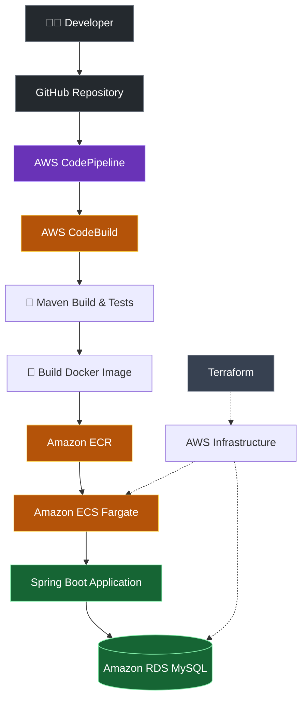

<div align="center">

# ☁️ Student Management System

### 🚀 AWS Cloud & DevOps | CI/CD Automation

**Code → Build → Test → Containerize → Deploy**

A containerized Java Spring Boot application deployed on AWS using automated CI/CD, Docker, Terraform, and Amazon RDS.


</div>

---

## 🚀 Project Overview

This project demonstrates how to automate the build, testing, containerization, and deployment of a Spring Boot application using AWS Cloud and DevOps tools.

The application runs on **Amazon ECS with AWS Fargate**, stores student records in **Amazon RDS for MySQL**, and uses **AWS CodePipeline and CodeBuild** for CI/CD.

## 🏗️ Architecture



## ⚙️ CI/CD Workflow

| Stage | Description |
|---|---|
| 📥 Source | Application code is maintained in GitHub |
| 🔨 Build | AWS CodeBuild builds the application |
| 🧪 Test | Configured automated tests are executed |
| 🐳 Containerize | Docker builds the application image |
| 📦 Publish | The image is pushed to Amazon ECR |
| 🚀 Deploy | Amazon ECS runs the containerized application |
| 🗄️ Persist | Student data is stored in Amazon RDS |

## 🛠️ Technology Stack

| Category | Technologies |
|---|---|
| Backend | Java 21, Spring Boot |
| Build Tool | Apache Maven |
| Database | MySQL 8.4, Amazon RDS |
| Database Migrations | Flyway |
| Containerization | Docker |
| Container Registry | Amazon ECR |
| Container Platform | Amazon ECS, AWS Fargate |
| CI/CD | AWS CodePipeline, AWS CodeBuild |
| Infrastructure as Code | Terraform |
| Version Control | Git, GitHub |
| Security | AWS IAM, Secrets Manager, Security Groups |

## ✨ Key Features

- 🔄 Automated CI/CD workflow using AWS services.
- 🐳 Docker-based application packaging and deployment.
- ☁️ Infrastructure provisioning using Terraform.
- 🗄️ Persistent student data storage using MySQL.
- 🧪 Automated testing and database integration testing.
- 🔐 IAM-based access control and managed database credentials.
- 🧰 Practical cloud deployment and troubleshooting experience.

## 💻 Run Locally

### Prerequisites

- Java 21
- Maven
- Docker and Docker Compose
- Git

### 1. Clone the Repository

```bash
git clone https://github.com/vijay-1806/java-springboot-devops-cicd-aws.git
cd java-springboot-devops-cicd-aws
```

### 2. Configure Environment Variables

Create a `.env` file containing the database environment variables required by your Docker Compose configuration.

Use strong passwords and never commit credentials or the `.env` file to GitHub.

### 3. Start the Application

```bash
docker compose up --build -d
```

### 4. Check Running Containers

```bash
docker compose ps
```

### 5. View Application Logs

```bash
docker compose logs -f
```

### 6. Stop the Application

```bash
docker compose down
```

**Note:** The database uses a named Docker volume for persistence. Avoid adding `-v` unless you intentionally want to remove the database volume.

## 🔐 Security Practices

- IAM roles and permissions for AWS services.
- Security groups to restrict network traffic.
- Private database networking.
- AWS Secrets Manager for database credentials.
- Environment-based application configuration.
- Non-root execution in the Docker container.

## 🔮 Future Enhancements

- 📊 Amazon CloudWatch monitoring, dashboards, and alarms.
- 🔵🟢 Blue/green deployments using AWS CodeDeploy.
- ↩️ Automated deployment rollback.
- 🛡️ Docker image vulnerability scanning.
- 🔒 Application Load Balancer with HTTPS.
- 📣 Deployment failure notifications.

## 📌 Project Status

**Current focus:** Validating the complete AWS CI/CD pipeline and documenting the deployment.

Monitoring, blue/green deployments, and advanced security automation are planned improvements.

## 👨‍💻 Author

**Vijayaragavan G.**

GitHub: [@vijay-1806](https://github.com/vijay-1806)

---

<div align="center">

### ☁️ Learn. Build. Automate. Deploy.

*Hands-on learning project focused on AWS Cloud and DevOps engineering.*

</div>
